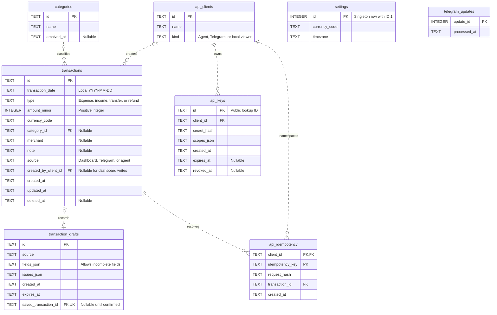

# Cloudflare D1 database schema

- Store lifecycle timestamps in UTC. Group reports by the transaction's local date. New entries use the configured currency.
- Store salary and other received payments as `transactions` rows with `type = 'income'`. Compute monthly income from active income rows by received date.
- Index `transactions(transaction_date, id)` and `transactions(category_id, transaction_date, id)`. Omit soft-deleted entries from ledger views and totals. Archive categories to keep historical rows readable.
- Confirm each draft with an atomic write that checks the draft is unsaved and unexpired, creates its ledger row, and links the two. Keep receipt images and raw credentials outside D1.
- Keep client identity stable across key rotations. Store only the hash of each random API key secret and enforce that key's scopes on every call.
- Use `(client_id, idempotency_key)` as a composite primary key. Write the idempotency record and transaction together. A matching retry returns the existing transaction ID, and a different request with the same key returns a conflict.
- Deduplicate Telegram deliveries by `update_id`. Record the processed update together with any database changes it produces.
